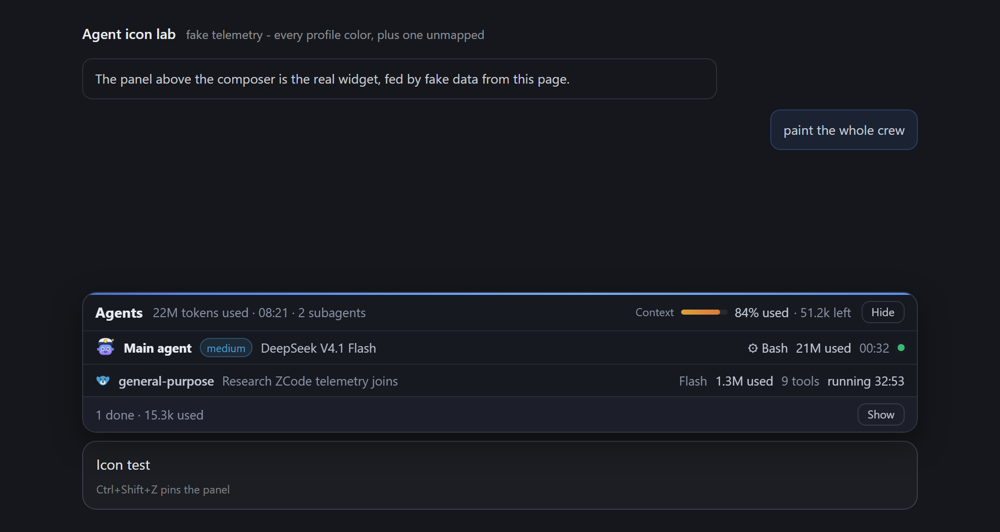
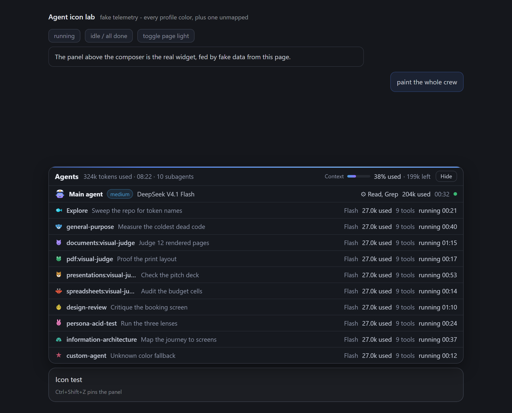

# ZCode এজেন্ট প্যানেল

**ইংরেজি সংস্করণ:** [README.md](README.md)

একটি **এজেন্ট প্যানেল, যা ZCode-এর চ্যাট বক্সের ঠিক উপরে পিন করা থাকে**: Main agent-এর একটি লাইন - কত টোকেন ব্যবহার হয়েছে আর কনটেক্সটে কত বাকি (শতাংশ ও টোকেনে), সময় আর আনুমানিক খরচ - আর কাজ চলার সময় প্রতিটি সাবএজেন্টের জন্য আলাদা লাইন। ডিজাইনটি [antigravity-agent-panel](https://github.com/mdnaeem-28/antigravity-agent-panel)-এর ধাঁচে বানানো; সব ডেটা আসে ZCode-এর নিজের লোকাল ফাইল থেকে। কোনো npm প্যাকেজ লাগে না - শুধু Node.js।



*চলমান অবস্থায়: হেডারে মোট হিসাব, Main agent-এর লাইন, একটি সাবএজেন্টের চলমান লাইন, আর গুটিয়ে যাওয়া "done" ফুটার। (ZCode চ্যাট উইন্ডোর বদলে একটি টেস্ট হার্নেসে তোলা ছবি।)*

---

## ডেমো ভিডিও

<video src="assets/demo.webm" controls muted loop></video>

ভিডিও না চললে: [ফাইলটি সরাসরি খুলুন](assets/demo.webm)

*রিপোর সাথে দেওয়া `icon-test.html` হার্নেসে রেকর্ড করা: এজেন্টরা কাজ করছে, সব শেষ হলে "done" ফুটারে গুটিয়ে যাচ্ছে, আবার কাজ শুরু হলে ফিরে আসছে।*

---

## আগে এটা পড়ুন: একবার রিস্টার্ট লাগবে

ZCode সাধারণত DevTools পোর্ট ছাড়াই চালু হয়, আর পোর্ট কেবল অ্যাপ চালু হওয়ার সময়ই চালু করা যায়। ইনস্টলারটি আপনার ZCode শর্টকাটে ফ্ল্যাগটি যোগ করে দেয়, তাই:

1. **ট্রে আইকন থেকে ZCode বন্ধ করুন।** শুধু উইন্ডো বন্ধ করলে হবে না - অ্যাপটি ব্যাকগ্রাউন্ডে চলতেই থাকে (`closeToTrayOnWindows` চালু থাকায়)।
2. **স্বাভাবিক আইকন থেকে আবার ZCode খুলুন।**

এরপর প্যানেলটি চ্যাট বক্সের উপরে নিজে থেকেই দেখা যাবে - প্রতিটি উইন্ডোতে, প্রতিটি সেশনে। আর কিছু করার নেই।

রিস্টার্ট করার আগেই দেখতে চান? যেকোনো ব্রাউজারে <http://127.0.0.1:4748/> খুলুন: একই উইজেট, একই লাইভ ডেটা, একটি নকল চ্যাট পেজে।

---

## প্যানেলে কী দেখা যায়

**হেডার - পুরো চ্যাটের হিসাব।** `Agents` শিরোনাম, তারপর main agent + সব সাবএজেন্ট মিলিয়ে ব্যবহৃত টোকেন, চ্যাটের মোট সময়, সাবএজেন্টের সংখ্যা। ডানে: **Context** - লাইভ বার, কত শতাংশ ব্যবহৃত আর কত টোকেন বাকি; আর **Hide** বাটন। কার্সর রাখলে সঠিক সংখ্যা দেখা যায়।

**Main agent সারি - সবসময় দেখা যায়।** মডেলের নাম, reasoning effort ব্যাজ (`max`, `enabled`, `light`), এখন কোন টুল চলছে, এই সেশনে ব্যবহৃত টোকেন, সক্রিয় সময়, আনুমানিক খরচ, আর একটি ডট - কাজ চললে সবুজ হয়ে জ্বলে।

**সাবএজেন্ট সারি - কাজ চলার সময়।** প্রতিটি সাবএজেন্টের একটি সারি: রঙিন ডট, প্রোফাইল টাইপ (`general-purpose`, `Explore`, কাস্টম এজেন্ট), আপনি যে কাজটি দিয়েছেন তার বিবরণ, মডেল, ব্যবহৃত টোকেন, টুল কতবার চলল, আর লাইভ স্টেটাস। কাজ শেষ হলে তারা নিচে ফুটার লাইনে গুটিয়ে যায়: `2 done · 1.5M used` - পাশে **Show** বাটন দিয়ে আবার লিস্ট করা যায়।

**আচরণ।** কোনো টার্ন শুরু হলে প্যানেল খোলে, সব থেমে গেলে ভাঁজ হয়ে যায়, আর চার মিনিট কিছু না হলে লুকিয়ে যায়; পরের টার্নে আবার ফিরে আসে। `Ctrl+Shift+Z` (macOS-এ `Cmd+Shift+Z`) চাপলে প্যানেল পিন হয়ে খোলা থাকে বা লুকায়; কোনো সারিতে ডাবল-ক্লিক করলেও একই কাজ হয়।



*প্রতিটি প্রোফাইল টাইপের জন্য আলাদা রঙ আর পিক্সেল-আর্ট এজেন্ট; অজানা রঙের জন্যও একটি fallback থাকে।*

## প্রয়োজনীয়তা

- Node.js **22.5 বা তার নতুন** (বিল্ট-ইন `node:sqlite` ব্যবহার করে)
- ZCode desktop - সাইন-ইন করা, অন্তত একটি চ্যাট আছে এমন
- Windows (macOS আর Linux-এর কোডপাথও আছে; অটোস্টার্ট সেখানে LaunchAgents / autostart দিয়ে হয়, তবে প্যানেলটি শুধু Windows-এ টেস্ট করা হয়েছে)

## ইনস্টল

```bash
git clone https://github.com/Abiruiux/zcode-agent-panel.git
cd zcode-agent-panel
node install.js
```

git না থাকলে: সবুজ **Code** বাটন → **Download ZIP**, আনজিপ করে ফোল্ডারটিতে ঢুকুন, তারপর একইভাবে `node install.js` চালান।

ইনস্টলার যা করে:

1. ডেমনটিকে লগইনে চালু হওয়ার জন্য রেজিস্টার করে,
2. এখনই চালু করে `http://127.0.0.1:4748`-এ,
3. শুধু Windows-এ: আপনার ZCode শর্টকাটে `--remote-debugging-port=0` যোগ করে। আগেরটি `shortcut-backups/` ফোল্ডারে ব্যাকআপ রাখা হয়, আর `uninstall.js` সব ফিরিয়ে দেয়।
4. ZCode-এর কোনো শর্টকাট না পাওয়া গেলে ডেস্কটপে `Launch ZCode with Agent Panel.lnk` নামে একটি লঞ্চার বানায়।

তারপর উপরের একবারের রিস্টার্টটি করুন।

## আনইনস্টল

```bash
node uninstall.js
```

ডেমন বন্ধ করে, লগইন এন্ট্রি মুছে ফেলে, প্রতিটি প্যাচ করা শর্টকাট আগের ব্যাকআপ থেকে ফিরিয়ে আনে, বানানো লঞ্চার থাকলে মুছে ফেলে। আপনার `panel-config.json` আর লগ থেকে যায়; সব মুছতে চাইলে পুরো ফোল্ডারটি মুছে দিন।

---

## কনফিগারেশন - `panel-config.json`

```json
{
  "port": 4748,
  "refreshMs": 1000,
  "idleCollapseMs": 20000,
  "idleHideMs": 240000,
  "contextLimits": { "default": 200000, "byModel": { "deepseek-ai/DeepSeek-V4.1-Flash": 320000 } },
  "pricing": { "byModel": { "GLM-5.3": { "input": 0.6, "output": 2.2, "cacheRead": 0.06 } } }
}
```

**`contextLimits` - শতাংশ ভুল মনে হলে এটা পড়ুন।** ZCode মডেলের কনটেক্সট উইন্ডোর সাইজ ডিস্কে রাখে না, তাই প্যানেল শতাংশ আর বাকি টোকেনের হিসাব করে এই সংখ্যাগুলোর ভিত্তিতে। দেওয়া সংখ্যাগুলো প্রমাণভিত্তিক: প্রতিটি মডেলের এন্ট্রি হলো এই মেশিনে সেই মডেলের সফলভাবে বহন করা সবচেয়ে বড় প্রম্পট, একটু গোল করা - কারণ সফল হওয়া মানে উইন্ডো অন্তত তত বড়। প্রকৃত উইন্ডো জানা থাকলে এখানে বসিয়ে দিন। কোনো পর্যবেক্ষিত রিকোয়েস্ট আপনার দেওয়া সংখ্যাটি ছাড়িয়ে গেলে প্যানেল শতাংশের বদলে `full` দেখাবে, আর টুলটিপ বলবে কোন সংখ্যাটি বাড়াতে হবে। ফাইল বদলানোর পর ডেমনটি রিস্টার্ট করুন (লগআউট হয়ে আবার লগইন, অথবা `taskkill` দিয়ে node প্রসেসটি বন্ধ করে `node daemon.js` চালান)।

**`pricing` - USD প্রতি ১M টোকেন, ইচ্ছাকৃতভাবে খালি।** প্যানেল কোনো মডেলের দাম নিজ থেকে ধরে নেয় না। কোনো মডেল আইডির জন্য `{"input": ..., "output": ..., "cacheRead": ...}` লিখলে হেডার ও সারিতে আনুমানিক `≈$` দেখাবে। `cacheRead` না দিলে input রেটের ১০% ধরা হয়। কোনো মডেল না থাকলে তার খরচ দেখানোই হয় না।

## সংখ্যাগুলো কোথা থেকে আসে

সবকিছু লোকাল, read-only, কোথাও পাঠানো হয় না:

| সোর্স | কী কাজে |
|---|---|
| `~/.zcode/cli/db/db.sqlite` (`model_usage`, `session`) | প্রতি রিকোয়েস্টের টোকেন, মডেল, মোড, effort, টুল সংখ্যা, এরর |
| `~/.zcode/cli/log/zcode-<date>.jsonl` | লাইভ turn/model/tool ইভেন্ট - এখন কী চলছে |
| `~/.zcode/cli/agents/<session>/agent_<id>/metadata.json` | সাবএজেন্ট রেজিস্ট্রি: টাইপ, বিবরণ, রঙ, স্টেটাস |
| ZCode উইন্ডো নিজেই (`[data-session-id]`, `data-running-subagent-ids`) | আপনি কোন চ্যাট দেখছেন, সত্যিই কোন সাবএজেন্টরা চলছে |

টোকেন টোটাল সঠিক: ZCode-এর নিজের usage রেকর্ড থেকে পড়া। প্রতিটি সাবএজেন্টের টোকেন তার নিজের চাইল্ড সেশন থেকে গোনা, তাই হেডারের মোট = main + সাবএজেন্ট - ডাবল কাউন্ট নেই।

## এটা কীভাবে কাজ করে

1. ডেমনটি ZCode-এর নতুন ইভেন্ট লগ tail করে আর SQLite ডেটাবেস পড়ে, সেকেন্ডে একবার একটি telemetry snapshot বানায়।
2. ZCode-এর DevTools পোর্ট খুঁজে বের করে `%APPDATA%/ZCode/session/DevToolsActivePort`-এ (ZCode তার Chromium প্রোফাইল `session/`-এ রাখে; ফাইলটি সেখানে ও পুরোনো `%APPDATA%/ZCode/` লোকেশনে খোঁজা হয়) এবং Chrome DevTools Protocol-এর মাধ্যমে প্রতিটি অ্যাপ উইন্ডোতে সংযুক্ত হয়।
3. `Page.addScriptToEvaluateOnNewDocument` দিয়ে প্যানেলটি রেজিস্টার করে, আর লাইভ ডকুমেন্টে একবার evaluate করে।
4. প্যানেলটি একটি shadow root-এ থাকে, চ্যাট কম্পোজার (`[data-lexical-editor="true"]`) খুঁজে বের করে তার ঠিক উপরে বসে, প্রস্থ মিলিয়ে নেয়। লেআউট খুঁজে না পেলে কম্পোজারের উপরে ভাসমান অবস্থানে চলে যায়।
5. Telemetry পেজে **push** করা হয় ডেমন থেকে - তাই পেজের CSP, CORS, mixed-content নিয়ম প্যানেলকে ভাঙতে পারে না।
6. Watchdog: অ্যাপের রি-রেন্ডার প্যানেলকে চাপা দিলে ~১ সেকেন্ডেই আবার মাউন্ট হয়; প্যানেল ২৫ সেকেন্ড উত্তর না দিলে ডেমন আবার ইনজেক্ট করে।

## টেস্ট হার্নেস (ডেভেলপমেন্ট)

রিপোর `icon-test.html` ফাইলটি আসল প্যানেলটিকেই দেখায় - একটি নকল চ্যাট পেজে, নকল telemetry দিয়ে; স্ক্রিনশট আর ডেমো ভিডিও এটিই থেকেই তোলা। যেকোনো স্ট্যাটিক সার্ভার দিয়ে ফোল্ডারটি সার্ভ করে ব্রাউজারে খুললেই চলে (যেমন `npx serve .` বা `python -m http.server`)। আর `apply-panel.js` দিয়ে ZCode রিস্টার্ট না করেই চলমান উইন্ডোগুলোতে নতুন `panel.js` ঢুকিয়ে দেওয়া যায়।

## সমস্যা হলে

**চ্যাট বক্সের উপরে কিছু দেখা যাচ্ছে না।** ZCode এখনও রিস্টার্ট করা হয়নি, বা প্যাচ করা শর্টকাট ছাড়াই চালু হয়েছে। <http://127.0.0.1:4748/api/health> খুলে দেখুন: `cdpPort` যদি `null` হয়, ট্রে থেকে ZCode বন্ধ করে স্বাভাবিক আইকন থেকে খুলুন, আবার দেখুন।

**একবার দেখা গিয়েছিল, তারপর মিলিয়ে গেছে।** কার্ডের **Hide** বাটন চাপা পড়েছে, অথবা প্যানেল পিন করা না থাকলে চ্যাট `idleHideMs` (ডিফল্ট ৪ মিনিট) সময় নিষ্ক্রিয় ছিল। **Ctrl+Shift+Z** চাপলে ফিরে আসে; একই শর্টকাট প্যানেলটি পিন করে, ফলে নিষ্ক্রিয়তায় আর লুকায় না।

**প্যানেলে "waiting for the first reply" দেখা যাচ্ছে।** ঐ চ্যাটে এখনও কোনো মডেল কল রেকর্ড হয়নি। একটি মেসেজ পাঠান।

**শতাংশ নেই বা `full` লেখা।** মডেলের এন্ট্রিটি `contextLimits`-এ বাড়ান - উপরে দেখুন।

**পোর্ট 4748 ব্যস্ত।** ডেমন নিজে থেকে পরের খালি পোর্টে চলে যায়; আসল পোর্ট `panel-runtime.json`-এ লেখা থাকে এবং উপরের health URL-এ দেখা যায়।

**খরচ দেখাচ্ছে না।** সেই মডেল আইডির জন্য `pricing.byModel` পূরণ করুন।

পুরো লগ: এই ফোল্ডারের `daemon.log`। `cdp attached:` দিয়ে শুরু হওয়া লাইনগুলো ইনজেকশন নিশ্চিত করে।

## নিরাপত্তা নোট

ইনস্টলার ZCode-এ `--remote-debugging-port=0` যোগ করে, ফলে ZCode চলার সময় একটি **শুধু-localhost** ডিবাগিং সকেট খোলে (র্যান্ডম পোর্টে)। এটাই প্যানেলকে অ্যাটাচ হওয়ার সুযোগ দেয়; Antigravity, VS Code আর Chrome টুলিংও একই পদ্ধতি ব্যবহার করে। আপনার ইউজার অ্যাকাউন্টে চলা যেকোনো লোকাল প্রসেস ঐ সকেটে পৌঁছাতে পারে, তাই এটি না রাখতে চাইলে `node uninstall.js` চালিয়ে ফ্ল্যাগটি সরিয়ে ফেলুন। প্যানেলের নিজের সার্ভার শুধু `127.0.0.1`-এ বাঁধা এবং মেশিনের বাইরে কিছু পাঠায় না।

## কৃতজ্ঞতা

- অনুপ্রেরণা: [antigravity-agent-panel](https://github.com/mdnaeem-28/antigravity-agent-panel) - Md. Naeem; যেটি আবার `claude-agent-panel` থেকে অনুপ্রাণিত।
- MIT লাইসেন্স, দেখুন `LICENSE`।
