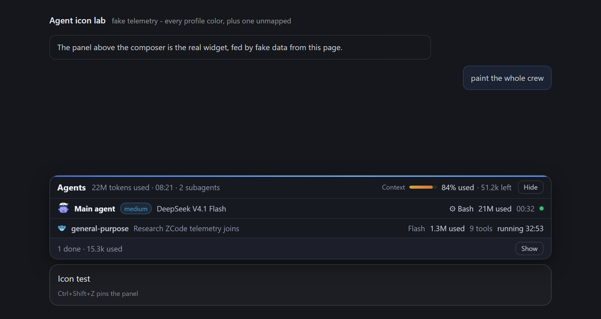
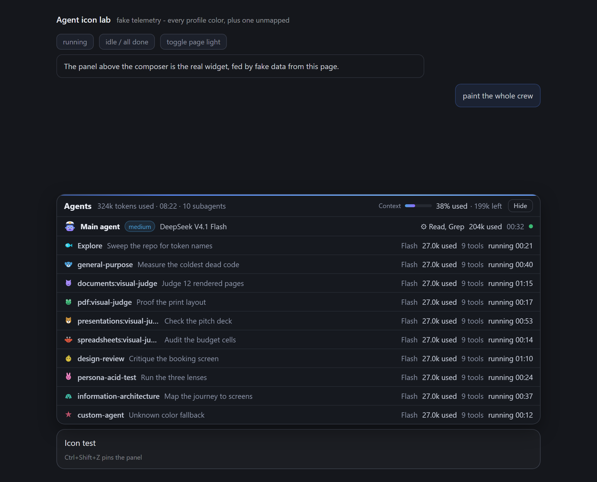

# ZCode Agent Panel

An **agent panel pinned above the ZCode chat box**: one Main agent row with the tokens used so far
and the context left, time and cost, plus one row per subagent while they work. Built after
the [antigravity-agent-panel](https://github.com/mdnaeem-28/antigravity-agent-panel) design; all data
comes from ZCode's own local files. Zero npm dependencies, pure Node.js.

**বাংলায় পড়ুন: [README.bn.md](README.bn.md)** - সম্পূর্ণ বাংলা গাইড: ইনস্টল, কনফিগারেশন আর সমস্যার সমাধান।



*Shown during a run: header totals, the Main agent row, one subagent row that is still working, and
the collapsed "done" footer. (Captured in a test harness that stands in for the ZCode chat window.)*

---

## Watch the demo

<video src="assets/demo.webm" controls muted loop></video>

If the video does not play, [open it directly](assets/demo.webm).

*Recorded on the bundled `icon-test.html` harness with sample telemetry: the crew runs, collapses
into the done footer when everything finishes, and comes back on the next turn.*

---

## Read this first: one restart is needed

ZCode starts without a DevTools port, and a port can only be switched on while the app is starting.
The installer adds the flag to your ZCode shortcut, so:

1. **Quit ZCode from the tray icon.** Closing the window is not enough, the app keeps running
   (`closeToTrayOnWindows` is on).
2. **Open ZCode again** from its usual icon.

After that, the panel appears above the chat box on its own, in every window, every session. There is
nothing else to do.

Want to see it before restarting? Open <http://127.0.0.1:4748/> in any browser: same widget, same live
telemetry, on a stand-in chat page.

---

## What the panel shows

**Header - the whole chat.** Title `Agents`, then the tokens used by the main agent plus all
subagents, the wall time of the chat, and the subagent count. On the right: **Context**, the live
usage bar with `% used` and the tokens left, and a **Hide** button. Hover any of them for exact
numbers.

**Main agent row - always visible.** The model name, its reasoning effort badge (`max`, `enabled`,
`light`), the running tool when one is in flight, tokens used this session, active time, estimated
cost, and a dot that pulses green while work is happening.

**Subagent rows - while they work.** One row per subagent: colored dot, profile type
(`general-purpose`, `Explore`, custom agents), the task description you gave it, model, tokens used, tool
count, and live status. When subagents finish they collapse into a footer line: `2 done · 1.5M used`
with a **Show** button to list them.

**Behaviour.** The panel opens when a turn starts, collapses when things go quiet, and hides itself
after four minutes of no activity; the next turn brings it back. `Ctrl+Shift+Z` (or `Cmd+Shift+Z`)
pins it open or hides it, double-clicking a row does the same.



*Every profile type gets its own color and pixel agent; an unmapped color falls back cleanly.*

---

## Requirements

- Node.js **22.5 or newer** (uses the built-in `node:sqlite`)
- ZCode desktop, signed in, with at least one chat
- Windows (macOS and Linux code paths are included; startup registration uses LaunchAgents /
  autostart, but the panel has only been tested on Windows)

## Install

```bash
git clone https://github.com/Abiruiux/zcode-agent-panel.git
cd zcode-agent-panel
node install.js
```

No git? Use the green **Code** button, then **Download ZIP**, unpack it, open a terminal in the
folder, and run the same `node install.js`.

The installer:

1. registers the daemon to start at login,
2. starts it now on `http://127.0.0.1:4748`,
3. Windows only: adds `--remote-debugging-port=0` to your ZCode shortcuts. The originals are copied to
   `shortcut-backups/` first, and `uninstall.js` restores them.
4. If no ZCode shortcut exists, it creates `Launch ZCode with Agent Panel.lnk` on your Desktop.

Then do the one-time restart above.

## Uninstall

```bash
node uninstall.js
```

Stops the daemon, removes the login entry, restores every patched shortcut from its backup, removes
the launcher if one was created. Your `panel-config.json` and logs are kept; delete the folder to
remove everything.

---

## Configuration - `panel-config.json`

```json
{
  "port": 4748,
  "refreshMs": 1000,
  "idleCollapseMs": 20000,
  "idleHideMs": 240000,
  "contextLimits": { "default": 200000, "byModel": { "deepseek-ai/DeepSeek-V4.1-Flash": 320000 } },
  "pricing": { "byModel": { "GLM-5.3": { "input": 0.6, "output": 2.2, "cacheRead": 0.06 } } }
}
```

**`contextLimits` - read this if the percentage looks wrong.** ZCode does not keep model context
window sizes on disk, so the panel computes the used percentage and the tokens left from these
numbers. The shipped values are evidence-based: each model's entry is the largest prompt that model has carried
successfully on this machine, rounded up, because a request that succeeded proves the window is at
least that big. If you know the real window from your provider, put it here. If an observed request
ever exceeds the value you set, the panel shows `full` instead of a percentage and the tooltip tells
you which number to raise. After editing the file, restart the daemon (log out and back in, or
`taskkill` the node process and run `node daemon.js`).

**`pricing` - USD per 1M tokens, empty on purpose.** The panel never invents what a model costs. Add
`{"input": ..., "output": ..., "cacheRead": ...}` for a model id and an estimated `≈$` appears in the
header and rows for it. `cacheRead` defaults to 10% of the input rate when omitted. Leave a model out
and its cost simply is not shown.

## Where the numbers come from

Everything local, read-only, nothing sent anywhere:

| Source | Used for |
|---|---|
| `~/.zcode/cli/db/db.sqlite` (`model_usage`, `session`) | per-request tokens, model, mode, effort, tool counts, errors |
| `~/.zcode/cli/log/zcode-<date>.jsonl` | live turn / model / tool events, what is in flight right now |
| `~/.zcode/cli/agents/<session>/agent_<id>/metadata.json` | subagent registry: type, description, color, status |
| the ZCode window itself (`[data-session-id]`, `data-running-subagent-ids`) | which chat you are looking at, which subagents are truly running |

Token totals are exact: they are read from ZCode's own usage records. Subagent tokens are counted from
each subagent's own child session, so the header total is main + subagents, no double counting.

## How it works

1. The daemon tails the newest ZCode event log and reads the SQLite database, building one telemetry
   snapshot per second.
2. It finds ZCode's DevTools port in `%APPDATA%/ZCode/session/DevToolsActivePort` (ZCode keeps its
   Chromium profile in `session/`; the file is checked there and in the older `%APPDATA%/ZCode/`
   location) and attaches to each app window over the Chrome DevTools Protocol.
3. It registers the panel with `Page.addScriptToEvaluateOnNewDocument` and evaluates it once in the
   live document.
4. The panel lives in a shadow root, finds the chat composer (`[data-lexical-editor="true"]`) and
   inserts itself directly above it, matching its width. If the layout cannot be found it falls back
   to a floating position above the composer.
5. Telemetry is **pushed** into the page by the daemon, so page CSP, CORS and mixed-content rules
   cannot break the panel.
6. Watchdogs: the panel re-mounts within about a second if the app re-renders over it, and the daemon
   re-injects if the panel stops answering for 25 seconds.

## The test harness (development)

`icon-test.html` in this repo renders the real panel above a mock composer, driven by sample
telemetry; the screenshots and the demo video were captured from it. Serve this folder with any
static server and open the page (for example `npx serve .` or `python -m http.server`). And
`apply-panel.js` re-injects the current `panel.js` into running ZCode windows without a restart.

## Troubleshooting

**Nothing appears above the chat box.** ZCode was not restarted yet, or it was started without the
patched shortcut. Check <http://127.0.0.1:4748/api/health>: if `cdpPort` is `null`, quit ZCode from
the tray, open it from its usual icon, then check again.

**It was visible and then disappeared.** Either the **Hide** button on the card was pressed, or the
chat sat idle for `idleHideMs` (default 4 minutes) while the panel was not pinned. Press
**Ctrl+Shift+Z** to bring it back; the same shortcut pins the panel so idle time stops hiding it.

**The panel shows "waiting for the first reply".** That chat has no model calls recorded yet. Send a
message.

**The percentage is missing or says `full`.** Raise the model's entry in `contextLimits`, see above.

**Port 4748 is busy.** The daemon moves to the next free port automatically; the real port is written
to `panel-runtime.json` and shown by the health URL above.

**Cost is missing.** Fill in `pricing.byModel` for that model id.

Full log: `daemon.log` in this folder. Lines starting with `cdp attached:` confirm the injection.

## Security note

The installer adds `--remote-debugging-port=0` to ZCode, which opens a **localhost-only** debugging
socket on a random port while ZCode runs. That is what allows the panel to attach; it is the same
mechanism Antigravity, VS Code and Chrome tooling use. Any local process running as you could reach
that socket, so if you would rather not keep it, run `node uninstall.js` to remove the flag. The
panel's own server binds `127.0.0.1` only and sends nothing off the machine.

## Credits

- Inspired by [antigravity-agent-panel](https://github.com/mdnaeem-28/antigravity-agent-panel) by
  Md. Naeem, itself inspired by `claude-agent-panel`.
- MIT licensed, see `LICENSE`.
